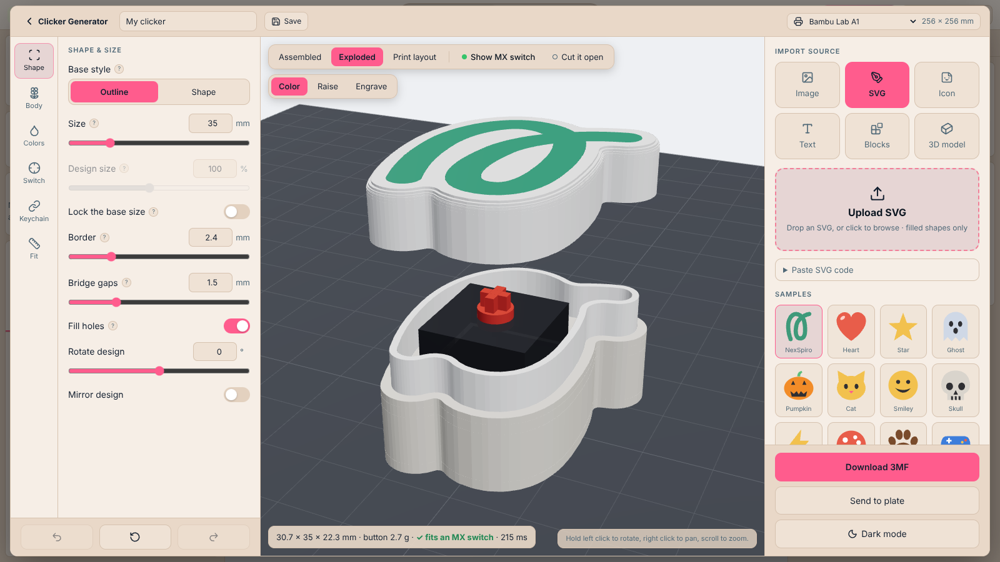
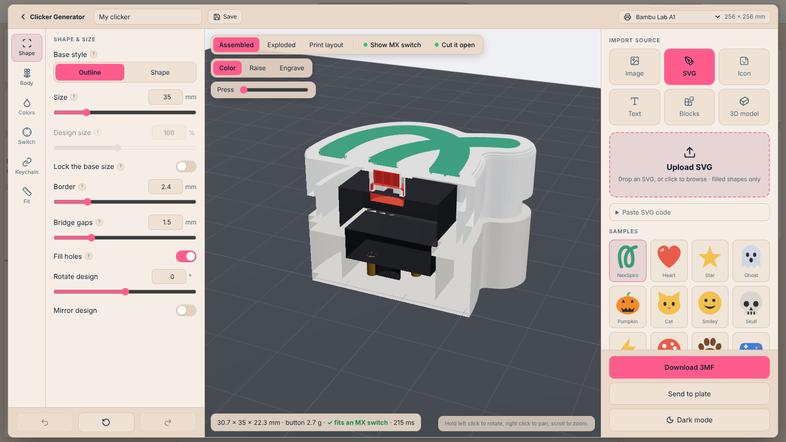
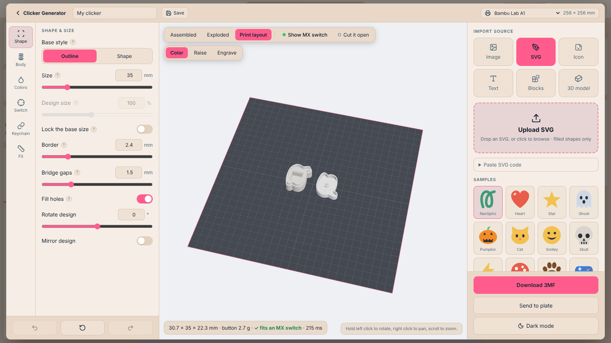
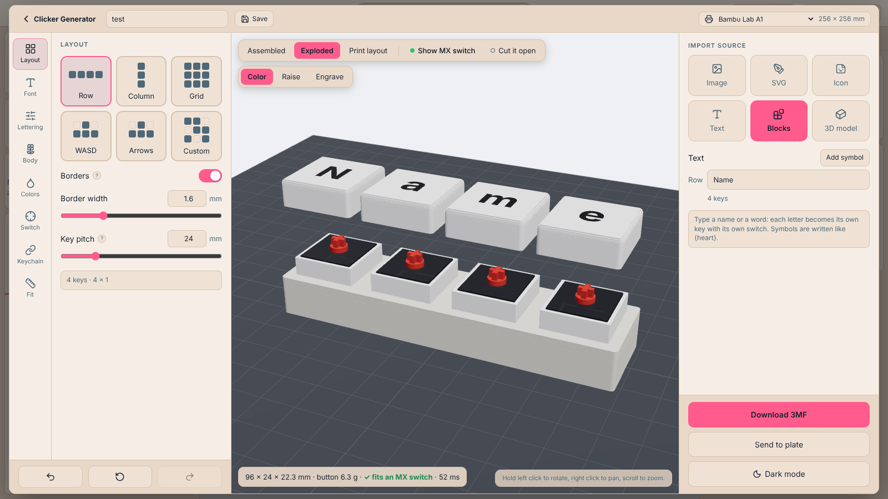
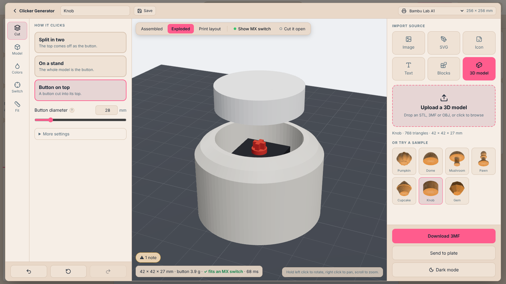

# Clickex: fidget clickers from any design

Clickex is NexSpiro's seventh plugin. It turns an image, SVG, icon, text, a row of name keys or a 3D model into a clicker built around a mechanical keyboard switch (MX-style), with a live 3D view while you edit. It is modelled on MakerWorld's clicker generator and adds fit checks, a press test, a fit-test print and more.

Status: **installed from Plugins → Clickex**. Geometry is placed on the plate as ordinary objects, so the slicer needs nothing from the plugin.

| Studio | Notes |
| --- | --- |
|  | Outline style: the body follows the design. The switch is placed at the widest point and turned to whatever angle fits. |
|  | **Cut it open**, with the real switch (housing, stem, pins) and a **Press** slider that moves the button through its travel. |
|  | **Print layout**: every part the way it sits on the bed, buttons face down. |
|  | **Blocks**: each letter is a key with its own switch. Row, Column, Grid, WASD, Arrows, Custom. |
|  | **3D model**: Split in two, Button on top, On a stand. |

## Sources

Image (PNG/JPG, colours traced), SVG (filled shapes), Icon (1,891 Lucide icons, ISC licence in `src/plugins/clickex/data/`), Text (5 bundled fonts), Blocks, 3D model (STL, OBJ, 3MF).

## Parts

- **Base**: floor, switch well, plate with the 14 mm hole, pocket for the 15.6 mm housing, and a rim the button slides over.
- **Button**: rounded top with the design inlaid (Color), raised (Raise) or cut in (Engrave), a skirt, and a boss whose lower stub enters the switch housing, with the cross socket.
- Colours become filament slots on **Send to plate**; **Download 3MF** writes the parts in print orientation with per-triangle colours.

## Beyond the MakerWorld editor

Auto switch placement and turn, base growth when the switch does not fit (and the smallest size that does), fit report (size, grams, stem engagement), press test, print layout view, fit-test clicker, keychain loop, bridge gaps and fill holes for outlines, mirror and rotate, engrave mode, symbols on keys, custom key grids, undo/redo, saved designs, project-file support, and a printer selector.

## Honest limits

- Switch heights are nominal (housing top 6.6 mm, stem top 10.2 mm above the plate). They are editable under Switch → Switch dimensions. **Print the fit test first** (Fit → Send a fit test to the plate).
- MX-style only for now. Choc and others are not in the catalogue yet.
- Model mode needs closed models. Buttons from models print upright with a hollow underside and need supports.
- Raise mode hangs its relief below the face when printing; use supports.

Tests: `tests/clickex/`.
