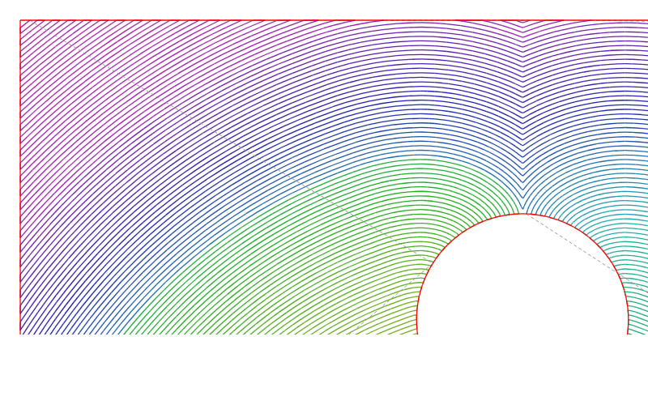

# Hanex — support-free horizontal overhangs

Hanex is Nexspiro's third plugin. It prints flat (90°) and slightly rising (up to ~97°) overhangs in mid-air on a 3-axis FDM printer, with no support material. It does this with "wave" toolpaths: each new arc fuses sideways onto the previous one.

Status: **core engine done and tested; calibration prints ready to run.** There is no UI panel yet, and Hanex is not yet connected to the slicer.

*Reference scenario (HNX-05). Colour shows print order, red is the rim and dashed lines are travels. The fronts start at a point inside the anchor (bottom), bend round the hole, and meet in a shock line behind it.*

## Pipeline (one layer)

| Step | What | Code |
| --- | --- | --- |
| 0 | Detection: `overhang = layer Z − layer Z−1`, keeping only parts wider than the trigger width; `anchor = layer Z ∩ layer Z−1` | `core/detect.ts` |
| A | Geodesic distance field, `\|∇D\| = 1/F`, solved by the Fast Marching Method over overhang ∪ anchor band; holes are impassable | `core/fmm.ts` |
| B | Wavefronts are the iso-contours of D at `kΔd` (marching squares, all levels in one pass), clipped to the printable region | `core/contour.ts`, `core/plan.ts` |
| C | Sequencing: arcs are printed in dependency order, with short gaps bridged by extruding links | `core/plan.ts` |
| D | Extrusion: sheet volume `Δd·h·flowRatio·mod(R)` per mm, plus fan and feedrate | `core/plan.ts`, `core/gcode.ts` |

## The maths

- **Wave spacing:** `Δd = w·(1 − overlap)`.
- **Nozzle-land bound:** the land must still press on the previous arc. Its far edge sits at `Δd + w/2` from the nozzle axis, and that must be within `tip/2`, so `Δd ≤ (tip − w)/2`.
  - With a 1.0 mm land and a 0.45 mm bead, overlap must be at least 39%.
  - `validateProfile` enforces this.
- **Distance field:**
  - Solver: FMM with a second-order upwind stencil.
  - Seeding: exact Euclidean distance in a tube of 6 grid steps around each seed.
  - Grid step: `h = min(Δd/3, w/4)`.
  - Measured errors (`tests/hanex/fmm.test.ts`):
    - straight front: exact (< 1e-9 mm);
    - point source at h = 0.1 mm: < 10 µm out to 20 mm away;
    - error converges as h shrinks;
    - behind a circular obstacle: within 4h of the exact taut-string geodesic (tangent + arc + tangent).
- **Diffraction:** nodes inside holes are outside the domain, so they have F = 0. D is therefore the geodesic distance, and the fronts wrap round holes instead of jumping across them.
- **Clipping:** arcs are clipped to `(overhang ∪ lead-in band) ⊖ w/2`, so no bead centre comes within half a bead of a hole or a free edge.
- **Anchor clamping:**
  - An arc whose ends reach the solid keeps exactly `leadIn` mm of arc length on the anchor at each end.
  - Arcs that lie entirely on solid are dropped, because the normal slicer already prints there.
- **Sequencing:**
  - Each piece of front `k` depends on the pieces of front `k−1` within `1.5Δd` of it.
  - Among the ready pieces, the nearest is printed next.
  - So one side of a hole is swept for many levels, and the pieces behind the hole wait until both sides arrive.
  - On the reference case this cuts travels from 138 (strict level order) to 12.
  - Gaps up to 3w are printed as extruding links.
- **Extrusion:**
  - Volume per mm is `Δd·h`, so beads at spacing Δd fill the sheet exactly.
  - Curvature modulation: `mod = clamp(R/R_nom, flowFloor, 1)`, with R the circumradius over a ±w chord.
  - The floor (default 0.6) stops tight turns from starving the bead.
- **Rising faces:**
  - φ is the angle between wall and underside: 90° is a flat ceiling; 95° means the underside rises 5° away from the wall.
  - Each layer then adds a free band `b = h / tan(φ − 90°)`: 2.29 mm at 95° with 0.2 mm layers.
  - Hanex waves each band onto the previous layer's sheet. Detection handles this automatically.
  - Above `maxWaveFaceAngle()` the band is narrow enough for a normal overhang.

## Works on any model

- Hanex needs only the cross-sections of layer Z and layer Z−1, as Clipper paths: `planLayer(current, below, profile)`.
- That is the same data the slicer already has for every object, so imported meshes need no special handling.
- What it handles:
  - multiple overhang components per layer;
  - islands inside the overhang, which act as extra anchors;
  - holes, which act as obstacles.
- Floating islands with nothing solid next to them are reported, not printed.

## Limits

- **Clamping at both ends is only possible where the front still reaches the anchor.**
  - Once an arc is wider than the overhang, its ends land on free edges.
  - There they are tied by the rim, which is printed last along every free edge, not by the anchor.
- **Edge seeding** (straight fronts from the whole anchor edge) has no hoop effect and no end clamping.
  - It is kept as an option for HNX-06 to compare against.
- **Speed function F(x, y)** is supported by the solver (`PlanOptions.speed`) but is not exposed in profiles yet.

## Next steps

- Connect Hanex to the slicer as an `EnginePlugin`:
  - `prepare` / `reshape` to remove the overhang from normal infill;
  - `postToolpath` to insert the wave moves.
- Add the right-dock panel with profile presets and the calibrated values.

## Files

- `src/plugins/hanex/core/*` — engine.
- `tests/hanex/*` — 39 tests.
- `docs/hanex/CALIBRATION.md` — printer calibration procedure.
